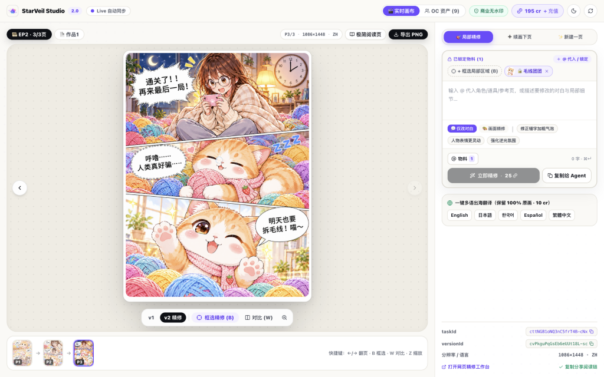

# 🎨 StarVeil Comic Studio Skill (Skill-First · Zero MCP Config)

> **Skill-First Plug-in Comic & Webtoon Production Desk for Claude Code, Codex, Cursor, Antigravity & OpenClaw.**
> **Zero `mcp.json` editing. Zero IDE restart. Auto 1-click browser sign-in on first command.**
> **Bring your own agent. Bring your own local scripts, novel chapters, Obsidian notes & OC folders.**
> StarVeil is *not* a restrictive black-box story writer — give your agent `SKILL.md` and it plugs a DaVinci-style Live Studio 2.0 canvas, local project checkpointing, 0-credit photo OC locking, drag-to-box editing, and 6-language localization directly into your workflow.

<p align="center">
  <a href="https://starveilai.com"></a>
  <a href="https://starveilai.com/SKILL.md"></a>
  <a href="https://starveilai.com/pricing"></a>
  <a href="./LICENSE"></a>
  <a href="https://glama.ai/mcp/connectors/com.starveilai/star-veil-ai"></a>
</p>

<p align="center">
  
</p>

---

## Why Skill-First (Instead of Heavy MCP Setup or Closed Web Comic Forms)?

Your coding agent already reads your local disk and writes in your exact voice. You shouldn't have to hand-edit `mcp.json`, restart your IDE, or pay constant MCP schema token overhead just to draw comics.

**StarVeil splits the workflow cleanly:**

| Layer | Owned By | What It Does |
| :--- | :--- | :--- |
| **Story Brain & Local Files** | **Your Host Agent** (Claude Code / Codex / Cursor / Antigravity / OpenClaw) | Reads your existing novel `.md`, Obsidian vault, product docs, git history & local `cast/` photo folders in your exact voice |
| **Production Playbook & Project State** | **This MIT-Licensed Skill Pack** (`SKILL.md` + `references/`) | Teaches your agent local project management (`starveil-project.json` + `manifest.json`), faithful script-to-panel pacing, and 3-zone box-repair QA — 100% forkable and customizable |
| **Rendering, OC Anchors & Live Canvas** | **Zero-Dep `starveil` CLI + Live Studio 2.0** *(optional MCP at `/api/mcp`)* | Auto-opens 1-click browser login on first run, locks photo OCs at 0 cr, chains multi-page continuity (`previousTaskId`), fixes bubbles in-place (`0..1` bbox), translates 6 languages, and pops open Live Studio 2.0 |

---

## Modular Skill Architecture (Included in This Repo)

```text
starveil-comic-skill/
├── SKILL.md                                  # Core plug-in production loop & local workspace convention
├── server.json                               # Official MCP Registry manifest (com.starveilai/star-veil-ai@2.0.0)
└── references/
    ├── local-project-workspace.md            # starveil-project.json, cast/ 0-cr sync & cross-agent manifest.json resume
    ├── faithful-script-to-panels.md          # Adapt your own scripts/novels into crisp panels without mutating canon
    └── visual-qa-and-box-repair.md           # 7-point visual QA rubric + 3-Zone 0..1 bounding-box repair templates
```

### Key Capabilities
- **Bring Your Own Local Assets (Zero Lock-In)** — Native support for **Obsidian Fiction Vaults** (`Characters/*.md` YAML frontmatter), **Fountain `.fountain` comic scripts**, and **SillyTavern / Chub `chara_card_v2` PNG character cards** (`starveil oc import ./card.png` auto-extracts lore & locks the portrait at **0 credits**!). Switch from Claude Code to Cursor next week and resume Page 6 seamlessly via `manifest.json` + `previousTaskId`.
- **Persistent OC Identity Vault (0 credits for photo lock)** — Sync local photos or character sheets once (`create_character`) and cache `localName ↔ characterId` in `starveil-project.json`.
- **Native Live Studio 2.0 Side Pane + Companion URL** — Embedded MCP App inside **Antigravity**, plus passwordless **Companion Live Studio URLs** for **Claude Code, Cursor, Codex, and OpenClaw**.
- **Drag-to-Box Surgical Self-Editing** — Fix one typo, speech bubble, or hand inside a `0..1` normalized box (`edit_comic_page`) and verify with a **Before / After Wipe Slider**.
- **True Multi-Page Continuity (`previousTaskId`)** — Locks cast, outfits, lighting, and ink from Page 1 onto fresh panel compositions for Page 2+.
- **1-Click 6-Language Localization (`10 cr/page`)** — Translate finished pages into `EN / ZH-CN / ZH-TW / JA / KO / ES` while keeping 100% of original artwork (`translate_comic`).
- **Zero-Card Free Trial** — Every verified account starts with **1 free full comic page + 1 free surgical edit + unlimited 0-cr photo OC locks**. Pay-as-you-go packs start at `$6` (1,000 never-expiring credits, ~40 pages) and unlock 100% watermark-free commercial PNGs.

---

## ⚡ 10-Second Setup (Skill-First — Zero MCP Config)

### Option 1 — Zero Install (Just Paste One Sentence to Any Agent)
Tell Claude Code, Codex, Cursor, Antigravity, or OpenClaw:
> *"Read `https://starveilai.com/SKILL.md` and use the StarVeil skill directly to turn my story into a comic page (no MCP config needed — auto-open browser sign-in on first run)."*

### Option 2 — 1-Line Skill & Zero-Dep CLI Installer (Recommended)
```bash
curl -fsSL https://starveilai.com/install.sh | bash
```
Installs the zero-dependency `starveil` CLI (Node 20+, zero npm packages) and drops `SKILL.md` + `references/` into Claude Code, Codex, Cursor, Antigravity, and OpenClaw automatically.
- On the first command (`starveil balance`, `starveil page ...`, or `starveil studio`), the CLI **automatically opens 1-click browser sign-in** and saves a revocable `sv_live_...` key locally.
- In remote/SSH/cloud sandboxes without a local browser, the CLI returns instant JSON with `verificationUrl` + `starveil auth wait <deviceCode>` so your agent never hangs.
- Running `starveil studio --task <taskId>` automatically opens the passwordless **Live Studio 2.0** canvas right beside your terminal.

### Option 3 — Optional Streamable HTTP MCP (No-Shell or MCP Apps Side-Pane Hosts)
```bash
claude mcp add --transport http starveil https://starveilai.com/api/mcp
```
> **Headless CI / OpenClaw / n8n**: Create a revocable key at [starveilai.com/app/agents](https://starveilai.com/app/agents) and export `STARVEIL_API_KEY="sv_live_..."`.

---

## 🪄 Real Prompts Using Your Own Local Files

1. **Turn Your Existing Novel / Script + Local Character Folder Into a Managed Comic Project**
   > *"Read `./chapter-01.md` and my character sheets in `./cast/`. Sync the cast to StarVeil at 0 credits, create `starveil-project.json` and an editable `episodes/ep01/script.md` keeping my exact dialogue, and let me approve Page 1 before rendering."*
2. **Resume a Serial Across Sessions or Editors**
   > *"Read `episodes/ep01/manifest.json`, pick up from Page 2's `taskId`, and render Page 3 faithfully from `script.md`. Download the PNG, visually QA every speech bubble, and box-fix any typos."*
3. **Turn a Git Repo / Release Notes Into a Launch Comic**
   > *"Read our latest git commits and `README.md`, then turn the launch story into a punchy 4-panel anime comic in English for X/Twitter — and translate the approved page to Japanese."*
4. **Pet / Selfie 3-Page Manga (0 cr photo lock + free Page 1)**
   > *"Lock `./my-cat.jpg` as an OC (0 credits) and draw Page 1 of a warm watercolor comic starring them. Open StarVeil Live Studio so I can watch live."*

---

## 🖼️ Real Unedited Output Examples

### 1. One-Shot 4-Panel Tech Meme Comic (`create_comic_page` — 0 Hand-Edits, 0 Typos)
<p align="center">
  
</p>

### 2. One Pet Photo → 3-Page Consistent Watercolor Manga (`previousTaskId`)
<p align="center">
  
</p>

### 3. Live Studio 2.0 — Light-Table Stage, Floating HUD, Drag-to-Box & Timeline
<p align="center">
  
</p>

### 4. Neo-Noir 3:4 Cinema & 9:16 Vertical Webtoons
<p align="center">
  
</p>

---

## 🧰 Included Capabilities (`starveil` CLI & Optional MCP — 18 Tools + Live Studio 2.0)

| Category | CLI Commands & Underlying Tools |
| :--- | :--- |
| **Interactive Canvas** | `starveil studio [--task <id>]` / `open_starveil_studio` (auto-opens Live Studio 2.0 URL + native Antigravity side pane) |
| **OC Identity Vault** | `starveil oc create --image` / `starveil oc import` / `starveil oc list` (`create_character` 0 cr photo lock, `list_my_characters`, `get_character_status`) |
| **Comic Production** | `starveil page` / `starveil produce --auto-qa --auto-fix` / `starveil edit` / `starveil sync` (`create_comic_page`, `get_comic_page`, `edit_comic_page`) |
| **Vertical Webtoons** | `starveil webtoon` (`create_webtoon_episode` 9:16 strip, `get_webtoon_status`) |
| **Global Localization** | `starveil translate` (`translate_comic` EN / ZH-CN / ZH-TW / JA / KO / ES, 10 cr/page, `get_translation_status`) |
| **Viral Recipes** | `xhs-comic`, `article-to-comic`, `pet-or-selfie-comic`, `global-localize` |
| **Account & Credits** | `starveil auth login/wait/status/logout`, `starveil balance`, `starveil doctor`, `starveil topup` (`get_me`, `get_credit_balance`, `create_topup_checkout`) |

---

## Links

- 🌐 **Official MCP Registry**: [com.starveilai/comic-webtoon-studio](https://registry.modelcontextprotocol.io/v0.1/servers/com.starveilai%2Fcomic-webtoon-studio/versions/latest) · [com.starveilai/star-veil-ai](https://registry.modelcontextprotocol.io/v0.1/servers/com.starveilai%2Fstar-veil-ai/versions/latest)
- 🟢 **Glama Verified Healthy Connector**: [glama.ai/mcp/connectors/com.starveilai/star-veil-ai](https://glama.ai/mcp/connectors/com.starveilai/star-veil-ai)
- 📖 **Live `SKILL.md` Spec**: [starveilai.com/SKILL.md](https://starveilai.com/SKILL.md)
- 🛠️ **Agent Docs & 18 Tools**: [starveilai.com/agents](https://starveilai.com/agents)
- 🔑 **API Keys Console**: [starveilai.com/app/agents](https://starveilai.com/app/agents)
- 💎 **Pricing (Pay-as-you-go, never expires)**: [starveilai.com/pricing](https://starveilai.com/pricing)
