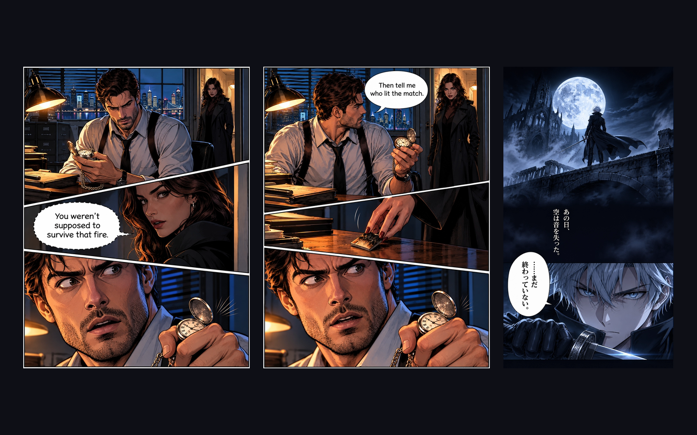

# 🎨 StarVeil Comic Studio Skill (`SKILL.md` + MCP)

> **Turn Claude Code, Antigravity, Cursor, Codex, or OpenClaw into a DaVinci-style comic & webtoon studio.**
> One photo + one sentence → multi-page consistent manga, drag-to-box speech-bubble editing, before/after wipe compare, and 6-language localization.

<p align="center">
  <a href="https://starveilai.com"></a>
  <a href="https://starveilai.com/SKILL.md"></a>
  <a href="https://starveilai.com/pricing"></a>
  <a href="./LICENSE"></a>
  <a href="https://glama.ai/mcp/connectors/com.starveilai/star-veil-ai"></a>
</p>

<p align="center">
  
</p>

---

## Why Developers & Creators Install This Skill

Normal image generators break down the moment you try to make a real comic: faces drift by Page 2, panels repeat rigidly, and fixing one typo inside a speech bubble burns credits rerolling the whole page.

**StarVeil 2.0 gives your AI Agent a real comic grading deck:**

- **Persistent OC Identity Vault (0 credits for photo lock)** — Upload a pet photo, selfie, or OC reference sheet once (`create_character`) and lock the exact face & outfit across Page 1 → Page 2 → Page 3.
- **Native Live Studio 2.0 Side Pane + Companion URL** — Renders natively inside **Antigravity** via MCP Apps, and auto-launches a passwordless **Companion Live Studio URL** next to **Claude Code, Cursor, Codex, and OpenClaw**.
- **Drag-to-Box Surgical Self-Editing** — Draw a normalized box directly on a single speech bubble or face (`edit_comic_page`) and inspect the fix with an instant **Before / After Wipe Slider**.
- **True Multi-Page Continuity (`previousTaskId`)** — Anchors cast, outfits, lighting, and ink LUT from Page 1 while forcing a fresh panel composition for Page 2+.
- **1-Click 6-Language Localization** — Translate finished pages into `EN / ZH / JA / KO / ES` while preserving 100% of original artwork (`translate_comic`).
- **Zero-Card Free Trial** — Every account starts with **1 free full comic page + 1 free surgical edit + unlimited 0-cr photo OC locks**. Pay-as-you-go credit packs start at `$6` (never expire; any pack unlocks commercial watermark-free PNGs).

---

## ⚡ 30-Second Setup

### Claude Code (One Command)
```bash
claude mcp add --transport http starveil https://starveilai.com/api/mcp
```
Then drop `SKILL.md` into your Claude skills folder (`~/.claude/skills/starveil-comic-studio/SKILL.md`) or run our universal installer:

### Universal Installer (Antigravity / Claude Code / Cursor / Codex)
```bash
curl -fsSL https://starveilai.com/install.sh | bash
```

### Cursor / Windsurf / Generic Streamable HTTP MCP Config
```json
{
  "mcpServers": {
    "starveil": {
      "url": "https://starveilai.com/api/mcp"
    }
  }
}
```
> **Headless / OpenClaw / CI Scripts**: Create a Bearer token at [starveilai.com/app/agents](https://starveilai.com/app/agents) and pass `Authorization: Bearer sv_live_...`.

---

## 🪄 Try Your First Prompt Right After Installing

Copy-paste any of these into Claude Code, Antigravity, or Cursor:

1. **Pet / Selfie 3-Page Manga (0 cr photo lock + free Page 1)**
   > *"Lock this photo of my cat as an OC (0 credits), then draw Page 1 of a 3-page warm watercolor manga where it unravels a giant red yarn ball and blames me when I walk in. Open StarVeil Live Studio so I can watch."*
2. **Article / Repo / Release Notes → 4-Panel Explainer Comic**
   > *"Read my latest git commit / README and turn the launch story into a punchy 4-panel anime comic in English for X/Twitter. Keep speech bubbles crisp and legible."*
3. **Surgical Bubble Fix + Japanese Export**
   > *"Keep the art untouched, change the speech bubble in panel 3 to 'Go touch grass.', and translate the finished page to Japanese."*

---

## 🖼️ Real Unedited Output Examples

### 1. One-Shot 4-Panel Tech Meme Comic (`create_comic_page` — 0 Hand-Edits, 0 Typos)
<p align="center">
  
</p>

### 2. One Pet Photo → 3-Page Consistent Watercolor Manga (`previousTaskId`)
<p align="center">
  
</p>

### 3. Live Studio 2.0 — Light-Table Stage, Floating HUD, Drag-to-Box & Timeline
<p align="center">
  
</p>

### 4. Neo-Noir 3:4 Cinema & 9:16 Vertical Webtoons
<p align="center">
  
</p>

---

## 🧰 Included MCP Tools (18 Tools + 4 Native Recipes)

| Category | Tools |
| :--- | :--- |
| **Interactive Canvas** | `open_starveil_studio` (Native MCP App side pane + Companion Live Studio URL) |
| **OC Identity Vault** | `create_character` (0 cr photo lock / 20 cr AI sheet), `list_my_characters`, `get_character_status` |
| **Comic Production** | `create_comic_page`, `get_comic_page`, `edit_comic_page` (drag-to-box + text-only mode) |
| **Vertical Webtoons** | `create_webtoon_episode` (9:16 strip), `get_webtoon_status` |
| **Global Localization** | `translate_comic` (EN / ZH / JA / KO / ES), `get_translation_status` |
| **Viral Recipes** | `xhs-comic`, `article-to-comic`, `pet-or-selfie-comic`, `global-localize` |
| **Account & Credits** | `get_me`, `get_credit_balance`, `create_topup_checkout` |

---

## Links

- 🌐 **Try 1-Sentence Free Web Quickstart (No MCP needed)**: [starveilai.com](https://starveilai.com)
- 📖 **Live `SKILL.md` Spec**: [starveilai.com/SKILL.md](https://starveilai.com/SKILL.md)
- 🔑 **Agent & API Console**: [starveilai.com/app/agents](https://starveilai.com/app/agents)
- 💎 **Pricing (Pay-as-you-go, never expires)**: [starveilai.com/pricing](https://starveilai.com/pricing)
