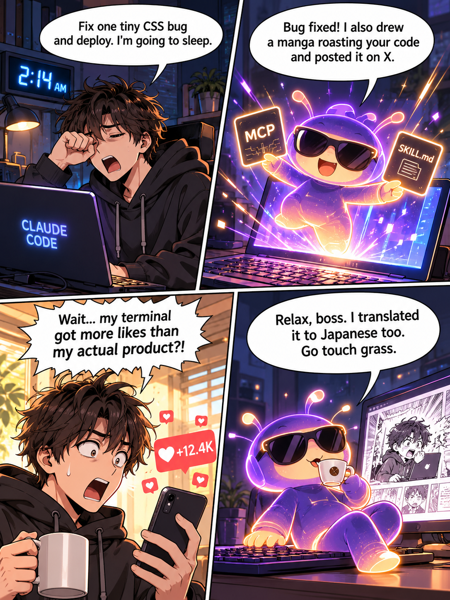

# 🎨 StarVeil Comic Studio Skill (`SKILL.md` + MCP)

> **Plug-in Comic & Webtoon Production Desk for Claude Code, Antigravity, Cursor, Codex & OpenClaw.**
> **Bring your own agent. Bring your own local scripts, novel chapters, Obsidian notes & OC folders.**
> StarVeil is *not* a restrictive black-box story writer — it plugs a DaVinci-style live comic studio, local project checkpointing, 0-credit photo OC locking, drag-to-box editing, and 6-language localization directly into your existing agent workflow.

<p align="center">
  <a href="https://starveilai.com"></a>
  <a href="https://registry.modelcontextprotocol.io/v0.1/servers/com.starveilai%2Fstar-veil-ai/versions/latest"></a>
  <a href="https://starveilai.com/pricing"></a>
  <a href="./LICENSE"></a>
  <a href="https://glama.ai/mcp/connectors/com.starveilai/star-veil-ai"></a>
</p>

<p align="center">
  
</p>

---

## Why a Plug-in Skill + MCP Desk (Instead of Another Closed Web Comic Agent)?

Your coding agent already reads your local disk and writes in your exact voice. Closed web comic apps force you to copy-paste lore into rigid forms and let a generic built-in writer mutate your dialogue.

**StarVeil splits the workflow cleanly:**

| Layer | Owned By | What It Does |
| :--- | :--- | :--- |
| **Story Brain & Local Files** | **Your Host Agent** (Claude Code / Antigravity / Cursor / Codex / OpenClaw) | Reads your existing novel `.md`, Obsidian vault, product docs, git history & local `cast/` photo folders in your exact voice |
| **Production Playbook & Project State** | **This MIT-Licensed Skill Pack** (`SKILL.md` + `references/`) | Teaches your agent local project management (`starveil-project.json` + `manifest.json`), faithful script-to-panel pacing, and 3-zone box-repair QA — 100% forkable and customizable |
| **Rendering, OC Anchors & Live Canvas** | **StarVeil Cloud MCP** (`https://starveilai.com/api/mcp`) | Handles what LLMs cannot: 0-cr photo OC locking, `previousTaskId` multi-page continuity, `0..1` drag-to-box editing, 6-lang translation, and DaVinci-style Live Studio 2.0 |

---

## Modular Skill Architecture (Included in This Repo)

```text
starveil-comic-skill/
├── SKILL.md                                  # Core plug-in production loop & local workspace convention
├── server.json                               # Official MCP Registry manifest (com.starveilai/star-veil-ai@2.0.0)
└── references/
    ├── local-project-workspace.md            # starveil-project.json, cast/ 0-cr sync & cross-agent manifest.json resume
    ├── faithful-script-to-panels.md          # Adapt your own scripts/novels into crisp panels without mutating canon
    └── visual-qa-and-box-repair.md           # 7-point visual QA rubric + 3-Zone 0..1 bounding-box repair templates
```

### Key Capabilities
- **Bring Your Own Local Assets (Zero Lock-In)** — Keep `bible.md`, `cast/` photos, `episodes/ep01/script.md`, downloaded PNGs, and `manifest.json` right inside your local folder or Git repo. Switch from Claude Code to Cursor next week and resume Page 6 seamlessly via `previousTaskId`.
- **Persistent OC Identity Vault (0 credits for photo lock)** — Sync local photos or character sheets once (`create_character`) and cache `localName ↔ characterId` in `starveil-project.json`.
- **Native Live Studio 2.0 Side Pane + Companion URL** — Embedded MCP App inside **Antigravity**, plus passwordless **Companion Live Studio URLs** for **Claude Code, Cursor, Codex, and OpenClaw**.
- **Drag-to-Box Surgical Self-Editing** — Fix one typo, speech bubble, or hand inside a `0..1` normalized box (`edit_comic_page`) and verify with a **Before / After Wipe Slider**.
- **True Multi-Page Continuity (`previousTaskId`)** — Locks cast, outfits, lighting, and ink from Page 1 onto fresh panel compositions for Page 2+.
- **1-Click 6-Language Localization (`10 cr/page`)** — Translate finished pages into `EN / ZH-CN / ZH-TW / JA / KO / ES` while keeping 100% of original artwork (`translate_comic`).
- **Zero-Card Free Trial** — Every verified account starts with **1 free full comic page + 1 free surgical edit + unlimited 0-cr photo OC locks**. Pay-as-you-go packs start at `$6` (1,000 never-expiring credits, ~40 pages) and unlock 100% watermark-free commercial PNGs.

---

## ⚡ 30-Second Setup

### Claude Code (One Command)
```bash
claude mcp add --transport http starveil https://starveilai.com/api/mcp
```
Then drop `SKILL.md` + `references/` into `~/.claude/skills/starveil-comic-studio/` or run the universal installer:

### Universal Installer (Antigravity / Claude Code / Cursor / Codex / CLI)
```bash
curl -fsSL https://starveilai.com/install.sh | bash
```

### Cursor / Windsurf / Generic Streamable HTTP MCP Config
```json
{
  "mcpServers": {
    "starveil": {
      "url": "https://starveilai.com/api/mcp"
    }
  }
}
```
> **Headless / OpenClaw / n8n / CI**: Create a revocable Bearer key at [starveilai.com/app/agents](https://starveilai.com/app/agents) and pass `Authorization: Bearer sv_live_...`.

---

## 🪄 Real Prompts Using Your Own Local Files

1. **Turn Your Existing Novel / Script + Local Character Folder Into a Managed Comic Project**
   > *"Read `./chapter-01.md` and my character sheets in `./cast/`. Sync the cast to StarVeil at 0 credits, create `starveil-project.json` and an editable `episodes/ep01/script.md` keeping my exact dialogue, and let me approve Page 1 before rendering."*
2. **Resume a Serial Across Sessions or Editors**
   > *"Read `episodes/ep01/manifest.json`, pick up from Page 2's `taskId`, and render Page 3 faithfully from `script.md`. Download the PNG, visually QA every speech bubble, and box-fix any typos."*
3. **Turn a Git Repo / Release Notes Into a Launch Comic**
   > *"Read our latest git commits and `README.md`, then turn the launch story into a punchy 4-panel anime comic in English for X/Twitter — and translate the approved page to Japanese."*
4. **Pet / Selfie 3-Page Manga (0 cr photo lock + free Page 1)**
   > *"Lock `./my-cat.jpg` as an OC (0 credits) and draw Page 1 of a warm watercolor comic starring them. Open StarVeil Live Studio so I can watch live."*

---

## 🖼️ Real Unedited Output Examples

### 1. One-Shot 4-Panel Tech Meme Comic (`create_comic_page` — 0 Hand-Edits, 0 Typos)
<p align="center">
  
</p>

### 2. One Pet Photo → 3-Page Consistent Watercolor Manga (`previousTaskId`)
<p align="center">
  
</p>

### 3. Live Studio 2.0 — Light-Table Stage, Floating HUD, Drag-to-Box & Timeline
<p align="center">
  
</p>

### 4. Neo-Noir 3:4 Cinema & 9:16 Vertical Webtoons
<p align="center">
  
</p>

---

## 🧰 Included MCP Tools (18 Tools + Live MCP App + 4 Native Prompts)

| Category | Tools |
| :--- | :--- |
| **Interactive Canvas** | `open_starveil_studio` (Native MCP App side pane + Companion Live Studio URL) |
| **OC Identity Vault** | `create_character` (0 cr photo lock / 20 cr AI sheet), `list_my_characters`, `get_character_status` |
| **Comic Production** | `create_comic_page`, `get_comic_page`, `edit_comic_page` (drag-to-box + text-only mode) |
| **Vertical Webtoons** | `create_webtoon_episode` (9:16 strip), `get_webtoon_status` |
| **Global Localization** | `translate_comic` (EN / ZH-CN / ZH-TW / JA / KO / ES, 10 cr/page), `get_translation_status` |
| **Viral Recipes** | `xhs-comic`, `article-to-comic`, `pet-or-selfie-comic`, `global-localize` |
| **Account & Credits** | `get_me`, `get_credit_balance`, `create_topup_checkout` |

---

## Links

- 🌐 **Official MCP Registry**: [com.starveilai/star-veil-ai@2.0.0](https://registry.modelcontextprotocol.io/v0.1/servers/com.starveilai%2Fstar-veil-ai/versions/latest)
- 🟢 **Glama Verified Healthy Connector**: [glama.ai/mcp/connectors/com.starveilai/star-veil-ai](https://glama.ai/mcp/connectors/com.starveilai/star-veil-ai)
- 📖 **Live `SKILL.md` Spec**: [starveilai.com/SKILL.md](https://starveilai.com/SKILL.md)
- 🛠️ **Agent Docs & 18 Tools**: [starveilai.com/agents](https://starveilai.com/agents)
- 🔑 **API Keys Console**: [starveilai.com/app/agents](https://starveilai.com/app/agents)
- 💎 **Pricing (Pay-as-you-go, never expires)**: [starveilai.com/pricing](https://starveilai.com/pricing)
